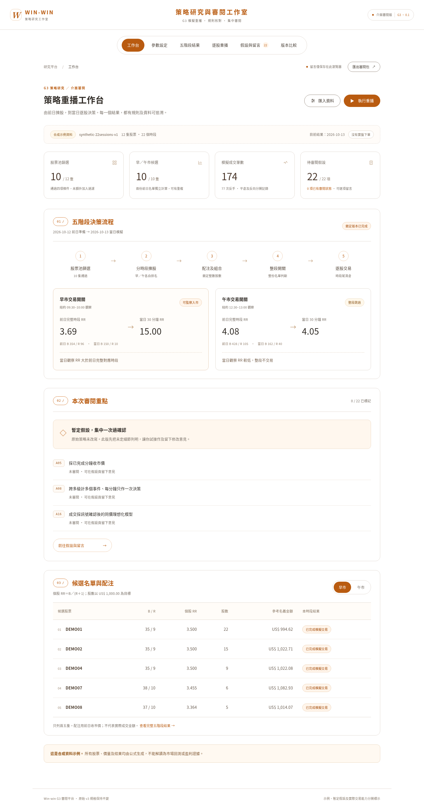

# G3 策略重播及審閱平台

香港繁體中文審閱版；純靜態網站、瀏覽器內計算、沒有第三方前端依賴、沒有實盤下單功能。

## 運行及測試

從此目錄執行 `npm start`，或從 repo 根目錄執行：

```sh
python3 -m http.server 8010 --bind 0.0.0.0 --directory sites/g3-platform
npm test --prefix sites/g3-platform
```

Node 22+ 用於內建測試；Python 3 只用於本地靜態伺服器。無需 `npm install` 或編譯。正式網站須以 HTTPS 提供，讓瀏覽器可計算 SHA-256；本機 loopback 亦受支援。

## 審閱流程

1. 工作台預設運行 12 隻虛構股票、22 個合成正常交易日，早市通過、午市跳過。
2. 在參數頁修改數值，儲存草稿後重新重播；舊運行不會改變，最多本地保留四次。
3. 核對五階段輸出、逐股圖表、持倉及成交。淨額是理想化成交下的賬本診斷，不是回測表現。
4. 在「假設與留言」逐項審閱 A01–A22，可標記接受暫定或要求修改；這只是意向，不會改寫策略。
5. 匯出 JSON 審閱包，將假設、留言、設定及運行結果一次過交回。留言只存在本瀏覽器；換裝置或清除網站資料前請備份。
6. 可以把審閱包匯回以還原留言，但不會自動執行其參數或替換運行紀錄。

原始 `model/parameters.json` 保留全部已定及未定規格；沒有把此版假設回寫成用戶已批准的規則。01c 對話仍未納入。



## 檔案與架構

- `engine.js`：設定及資料驗證、整數價格 Renko 計數、四項篩選、排名、配注、整段開關、持倉／理想化成交及指紋。
- `assumptions.js`：已知設定與 22 項暫定假設，供介面、匯出及文件使用。
- `app.js`：六個操作頁、草稿／鎖定運行、本地留言、比較、匯入及匯出。
- `index.html`、`styles.css`：響應式介面；不載入外部字型或套件。
- `tests/engine.test.js`：獨立手算、因果、邊界、無事件、平倉反手、零分母、資料缺漏及五階段測試。
- `build.json`：本地標示為 development；GitHub Actions 發布時注入實際程式 SHA。

## 自行匯入資料

先在參數頁下載目前資料作結構範本，另存及修改；不要覆寫 repo 原有研究輸出。檔案上限 40 MB，所有處理留在瀏覽器，不會上傳。自訂資料應標示 `kind: "imported"`。

```json
{
  "schemaVersion": 1,
  "id": "provider-reviewed-snapshot-001",
  "kind": "imported",
  "description": "資料範圍及用途說明",
  "providerStatement": "供應方、授權、價格調整及歷史股票池聲明",
  "instruments": [{
    "symbol": "EXAMPLE",
    "sessions": [{
      "date": "2026-10-13",
      "marketCap": 5000000000,
      "marketCapAvailableAt": "2026-10-13T13:29:00Z",
      "previousClose": 100,
      "bars": [{
        "time": "2026-10-13T13:30:00Z",
        "availableAt": "2026-10-13T13:31:00Z",
        "open": 100, "high": 100.2, "low": 99.9,
        "close": 100.1, "volume": 50000
      }]
    }]
  }]
}
```

上面只示範欄位，不能直接運行：每時段需要 390 根完整正常市況分鐘線，各股票相同日期，最後一日作交易日，之前至少有所選回看時段數。每個時段另有前收市價以計波幅分母；第一個回看日亦需要此欄位。時間必須含時區、按紐約 09:30–16:00 驗證；不補值、不猜分鐘內路徑。市場日曆、公司行動、歷史證券範圍與供應商資料真確性仍需外部核實。

## 部署

`.github/workflows/g3-review-pages.yml` 在 `g3-platform-review` 分支更新後測試及發布六個必要靜態檔案，不會發布匯入資料、留言或憑證。需要 repo 的 **Settings → Pages → Source: GitHub Actions** 已啟用，並允許此分支部署到 `github-pages` 環境。工作流程不得繞過 repo 的環境審批或保護設定。

預期 GitHub Pages 位置須以實際部署輸出為準；僅推送程式、工作流程或發布到預備分支，不代表已成功公開或網址已驗證。

公開審閱網址：**https://newprojectshkau.github.io/Win-win/**。用戶已啟用 Pages 及允許審閱分支；[部署記錄](https://github.com/newprojectshkau/Win-win/actions/runs/40761600840) 第三次嘗試成功。舊有 Not Found／分支保護問題已解除；往後更新仍須通過測試及部署。

介面風格：白底、橙色重點（取代舊綠色）、頂部膠囊導覽、編號章節及暖灰分隔線；較大的字體、表格行距及留言框。此改版沒有改動引擎、資料格式或本地儲存鍵。

最新閱讀調整以 `--font-scale: 1.3` 將各級字體統一增加 30%，保留原有層次；已用瀏覽器比較改動前後的計算字級，並在 1512px、390px、320px 檢查頁面寬度。沒有重設既有留言。

Massive 私人資料下載／重播工具見 [scripts/marketdata](../../scripts/marketdata/README.md)。Key 只用於安全環境內的 HTTPS 請求，不放進此公開前端；付費資料亦不自動發布到 Pages。實際訂閱下載及真實資料 dry run 仍取決於憑證綁定是否可用。

瀏覽器互動測試：先開啟本地靜態伺服器，再執行 `python3 sites/g3-platform/tests/browser_check.py`（從 repo 根目錄）；需要 Playwright Python 及 `/usr/bin/chromium`。可用 `G3_BASE_URL` 指向實際審閱網址，`G3_TEST_ARTIFACTS` 設定測試截圖／匯出位置。測試使用隔離的瀏覽器儲存，不會提交任何留言。

## 期間績效模擬

`simulator.html` 新增多日向前滾動重播、成本拆解、累計美元損益、收市最大回撤、逐日篩選／開關、逐股貢獻及成交追溯。原有六頁審閱平台保持可用，頂部新增入口。

公開版需要匯入私人 schema-v1 dataset，或明確選擇合成示例；不公開訂閱行情。私人預載版由 `scripts/marketdata/package_private_review.py` 生成，可離線開啟。資料與結果均可在瀏覽器內處理及匯出，沒有新增資料上傳服務。

`performance.js` 使用原有引擎逐日計算，只傳入當日及之前的回看視窗。`tests/performance.test.js` 覆蓋手算成本、收市回撤、零成交及未來資料隔離。收市回撤並非日內最大回撤；未模擬賬戶資金／保證金，因此不顯示年化及本金收益百分比。


2026-10-30：網站根入口現在開啟真實資料績效模擬器。原六頁規則工作台在 `review.html`。績效頁已移除合成示例入口，只接受 imported 資料；匯入後透過 IndexedDB 在本機保存。提供單日及日期範圍模式，可用起日會預留 20 個完整回看日。公開網站沒有私人資料伺服器，因此首次仍需匯入私人 JSON，或使用預載單檔 HTML。


2026-10-30 新增 `presentation.js`（數字／動態圖像及團隊筆記）及 `quality-audit.js`（固定資料指紋綁定的外部核對摘要）。動態播放器僅展示凍結結果，不修改引擎或計算設定。統計為日收市損益及回撤；成交播放器每步一筆，不宣稱時間等距。


2026-10-30：所有公開操作頁只使用真實資料。`review.html` 與期間模擬器共用 IndexedDB；舊合成結果不再顯示，留言保留。測試生成器移至 `tests/fixture-data.js`，不包含在 Pages artifact。私人載入頁提供三股兩星期及 AAPL 長期兩個組合，瀏覽器資料庫可切換已載入的組合。詳見 `docs/DATA-INVENTORY-zh-HK.md`；全年原始資料存在不等於所有日期可回測。
